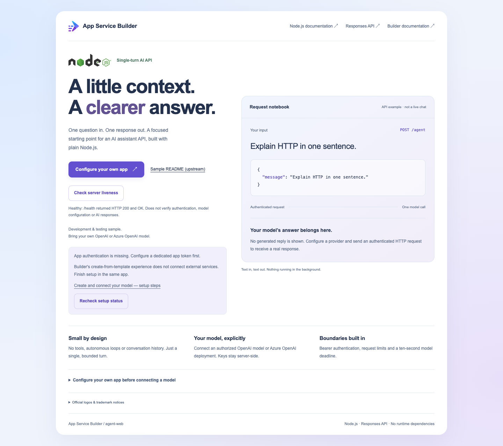

# AI assistant HTTP API on App Service Builder

A standalone Node.js 24 sample: each authenticated `POST /agent` sends one bounded text request to an external Responses-compatible model.

**External-service setup is manual.** Builder's create-from-template experience does not create or connect a model resource. An already deployed app opens the setup guide while `/agent` fails closed until configured. Follow [setup](#setup) in that same app.

**Private Preview, development/test only.** Approved Builder access and a supported target are required. Model availability and live connectivity are not qualified by this sample.

## Preview



This is the actual local page, not a live chat or hosted-model receipt. Official Node.js and Builder branding, ecosystem links and the informational notebook remain. The page never accepts credentials or sends prompts. **Configure your own app** opens inline customization; **Recheck setup status** reads only sanitized configuration/last-request status.

## Setup

Use this journey **after deploying your fork's root `builder.yaml` to Builder**. Keep the existing app and source connection. Obtain approval for Azure hosting/model charges and provider data handling first.

1. **Create a dedicated Azure OpenAI resource.** In [Azure Portal](https://portal.azure.com), search **Azure OpenAI**, select **Create**, and choose your authorized subscription, a dedicated service resource group (**Create new** if needed), unique name, a model-supported region and **Standard S0**. Review network access and pricing, then **Review + create**. The human provisioner needs **Cognitive Services Contributor** at this dedicated group; after creation, key retrieval/model management can be scoped to this resource. **Cognitive Services OpenAI Contributor** can deploy models but cannot retrieve keys: have the resource's authorized key administrator supply the key securely. These are operator roles, not app credentials.
2. **Deploy one model, not another web app.** Open the resource's **Model deployments > Manage Deployments**, then in Foundry (classic) **Deploy model > Deploy base model**. Choose a Responses-compatible text model such as `gpt-4.1-mini` (version `2025-04-14`) if available for your region/quota. Name the deployment, choose an available pay-as-you-go deployment type, reduce the token allowance to your test needs, review cost/data residency and **Deploy**. Record the exact deployment name. A resource alone is not a model deployment. Portal quota visibility may require **Cognitive Services Usages Reader** at subscription scope for the operator, never the app. See the [resource/deployment walkthrough](https://learn.microsoft.com/azure/ai-foundry/openai/how-to/create-resource), [role permissions](https://learn.microsoft.com/azure/ai-foundry/openai/how-to/role-based-access-control) and [Responses support](https://learn.microsoft.com/azure/foundry/openai/how-to/responses).
3. **Connect server-side settings.** In the resource's **Keys and Endpoint**, copy the HTTPS resource origin and a key directly into your existing Builder app's **Variables > Add variables**:

   | Name | Value |
   |---|---|
   | `MODEL_SERVICE` | `azure-openai` |
   | `AZURE_OPENAI_ENDPOINT` | `https://<resource>.openai.azure.com` (no path/query) |
   | `AZURE_OPENAI_DEPLOYMENT` | Exact deployment name from step 2 |
   | `AZURE_OPENAI_API_KEY` | Dedicated resource key |
   | `APP_API_TOKEN` | Newly generated, separate random token of at least 32 characters |

   Generate an app token in your approved secret manager; do not reuse an Azure/provider/account token. This sample uses API-key auth, **not managed identity**. Azure resource keys are resource-wide, not deployment-scoped: a dedicated resource is the isolation boundary. Do not grant the app Owner/Contributor or pretend RBAC scopes its key. Never place credentials in Git, browser code, prompts, screenshots or command history. Variables also reach builds: do not dump the environment or embed it in assets.
4. **Save AND deploy a new version.** Choose **Save and deploy**, follow **Deployments** to success, and verify the active version is the newly built one. **Save only**, a restart or deploying a retained old version does not apply new variables. If deployment could not start after save, deploy current source rather than re-entering secrets. With an already installed, signed-in Builder CLI, the equivalent new build is:

   ```bash
   builder app deploy --name "<existing-app>" \
     --subscription "<subscription-id>" --resource-group "<app-group>" --rebuild
   ```

5. **Verify an actual reply.** Use the returned HTTPS runtime origin. `/health` must return `200 OK`; it proves liveness only. `/api/setup` must show configured-but-unverified before a successful call. Supply the matching app token to an authorized terminal through your secret manager, then send one harmless prompt (Bash; header via stdin, not a command-line credential):

   ```bash
   APP_URL="https://<returned-app-origin>"
   curl --fail-with-body "$APP_URL/health"
   curl --fail-with-body "$APP_URL/agent" --header @- \
     -H "Content-Type: application/json" \
     --data '{"message":"Explain HTTP in one sentence."}' <<EOF
   Authorization: Bearer ${APP_API_TOKEN}
   EOF
   ```

   Require `200` and a nonempty `reply`, not the illustrative notebook. Missing/wrong client token must still fail. `/ready` remains `503` until a real response succeeds and returns to unverified after five minutes. It sends no probe/model request. Required platform sign-in is separate: browser sign-in is not a machine credential; follow [Builder authentication](https://builder.appservice.azure.com/docs/guides/authentication/) rather than disabling it to bypass an error.
6. **Clean up only what you own.** Delete this app only if disposable. In Azure Portal delete your dedicated model deployment/resource when finished and revoke its key and app token. Do not delete a shared group, model resource or account. App deletion does not stop separate model-service charges.

## Recovery

The runtime links to `./README.md#setup`, served by this app, rather than discovering your fork or modifying cloud settings. Recheck is manual and never calls the provider.

| Visible state | Next action |
|---|---|
| App auth/model configuration missing or invalid | Finish steps 2–4; correct the HTTPS resource origin. |
| Model missing (`404` from provider) | Check the exact deployment name and resource; deploy the model if absent. |
| Access denied (`401`/`403` from provider) | Check revoked/expired keys and service network/access policy. The app cannot reliably distinguish those causes. Rotate through secure settings, then deploy. |
| Limit, unreachable/timeout, unusable response | Review quota/billing, provider status and egress; retry one request explicitly after correction. No automatic retries. |
| Configured or recently successful | Configuration is not connectivity; only an actual completed reply verifies that request. |

Provider failures remain non-2xx (`502`, timeout `504`), with sanitized API errors and fixed public setup categories. Provider bodies, prompts, tokens and raw diagnostics are never logged or displayed. The guide cannot validate general model safety or provider retention; `store:false` is not a retention guarantee.

## Local development and contracts

See [local checks, alternate OpenAI configuration and HTTP limits](docs/development.md). Local tests mock the provider and incur no model calls:

```bash
npm test
```

The root manifest starts `node server.mjs` on port 8080 with `/health` as the **liveness** probe. `/ready` is separate, conservative dependency status; it is not the Builder probe. The showcase is not a credential form, chat UI, provisioning picker or autonomous agent. Customize `index.html` in your own fork, test, commit intended source and explicitly redeploy; the upstream README does not identify your fork.

## Resources

- [Host an AI agent on App Service Builder](https://builder.appservice.azure.com/docs/guides/host-ai-agent/).
- [OpenAI Responses API](https://platform.openai.com/docs/api-reference/responses) and [API pricing](https://openai.com/api/pricing/).
- [Official logo sources and trademark notices](assets/NOTICE.md).
- [Contributing](CONTRIBUTING.md), [MIT license](LICENSE.md), [Code of Conduct](.github/CODE_OF_CONDUCT.md).
- Report vulnerabilities privately to [MSRC](https://msrc.microsoft.com/report).
